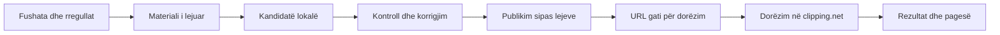

# Boti Studio: Kick, Stake dhe fushatat e streamerëve

**Shënim pas implementimit 0.4:** Ky është propozimi fillestar, i ruajtur si histori. Fushatat/dorëzimet lokale u ndërtuan në 0.3; Kick/Twitch dhe kontrolli/korrigjimi automatik në 0.4. Editor-i manual dhe paneli financiar janë shtyrë. Gjendja aktuale dokumentohet te [automatic-processing.md](automatic-processing.md).

Plan fillestar zhvillimi, 9 nëntor 2026. Ky dokument propozon funksionet e ardhshme; nuk deklaron integrim aktiv me clipping.net. Janë kontrolluar dokumentacioni publik dhe kodi lokal 0.2. Rregullat private, tarifat dhe gjendja e fushatave në llogarinë e përdoruesit nuk janë parë.

## Synimi

Lidhe çdo klip me fushatën, postimin publik, dorëzimin dhe rezultatin financiar të tij. Mat pranimin, shikimet e kualifikuara, pagesat e marra dhe kohën e harxhuar. Synimi 1,000+ klipe/ditë mbetet një matje kapaciteti, ndërsa vendimet për prodhim duhet të mbështeten edhe te rezultatet e fushatave.

## Çfarë ndryshon në planin fillestar

Sot Boti pranon vetëm Twitch VOD-e. Ka radhë, 4 agjentë, përzgjedhje lokale, titra, renderim dhe publikim YouTube/Instagram. TikTok përfundon manualisht. “Përmirëso” ndal publikimet automatike të ardhshme; nuk ofron ende ndryshim të prerjes ose titrave. Nuk ekzistojnë tabela për fushata, dorëzime ose pagesa.

Të katër PC-të vazhdojnë të marrin punë sipas aftësisë. Llogaritë caktohen sipas fushatës dhe audiencës; destinacioni i klipit mbetet i njëjtë edhe nëse renderimin e përfundon një PC tjetër.

## Kufizimet që ndikojnë drejtpërdrejt te projekti

Clipping.net lejon disa llogari sociale, por fushata mund të vendosë kufij për platformë. Kushtet kufizojnë identitetet Clipper dhe përmendin heqjen e postimeve të automatizuara ose me përpjekje të ulët. Automatizimi i pranueshëm për këtë përdorim duhet sqaruar me platformën; vlerësimi nga njeriu nuk është vetvetiu përjashtim nga kushtet. [Clipper Terms](https://clipping.net/policies/clipper-terms-and-conditions).

Dokumentacioni publik përshkruan dorëzimin e URL-së së një postimi publik në një llogari të lidhur. Rregullat e fushatës përcaktojnë kriteret konkrete dhe dorëzimi standard/bounty është zgjedhje për klipin. [Dorëzimi i klipeve](https://clipping.net/docs/clippers/campaign-detail).

Nuk u gjet dokumentacion publik për një API dorëzimi për palë të treta. Kushtet e përgjithshme kufizojnë aksesin me mjete të automatizuara. Versioni fillestar përdor përgatitje lokale dhe dorëzim manual; një lidhje e drejtpërdrejtë kërkon rrugë të dokumentuar dhe autorizim të qartë nga shërbimi. [Dokumentacioni](https://clipping.net/docs), [Terms of Service](https://clipping.net/policies/terms-of-service).

Shuma e shfaqur nga shërbimi mund të jetë vlerësim deri pas kontrollit dhe aprovimit. Postimet duhet të mbeten publike deri në pagesë. Paneli ynë duhet të dallojë parashikimin nga pagesa e marrë. [Payments](https://clipping.net/docs/clippers/payments).

Për klipet Stake që përmbajnë ose promovojnë kazino/baste, lejet dhe audienca kontrollohen veçmas. YouTube kufizon lidhjet drejt shërbimeve të pakualifikuara dhe mund të kufizojë përmbajtjen sipas moshës. “Not made for kids” nuk zëvendëson një kufizim 18+. Nuk supozohet se pranimi nga fushata e bën një klip të lejuar në çdo rrjet. [YouTube: regulated goods](https://support.google.com/youtube/answer/9229611), [Age restrictions](https://support.google.com/youtube/answer/2802167).

## 0.3 — Fushatat, burimet dhe dorëzimet

### Paneli i fushatave

Krijo modele bosh për Kick, Stake dhe streamerë të tjerë. Mos mbush tarifa ose limite nga kartat reklamuese të faqes. Për çdo fushatë ruaj:

- URL-në, ID-në e jashtme nëse njihet, emrin dhe streamerët/materialet e lejuara.
- Platformën, llogaritë e caktuara dhe verifikimin e tyre në clipping.net, veç lidhjes OAuth në Boti.
- Rregullat si tekst, datën e kontrollit dhe një version të tyre, që ndryshimet të mos humbin.
- Afatin, statusin, gjuhën/audiencën e kërkuar, kohëzgjatjen dhe udhëzimet për pamjen, logon, përshkrimin, zërin dhe shënimin e sponsorizimit kur kërkohet.
- Tarifat me monedhë dhe njësi të shprehur qartë: p.sh. për 1,000 ose 100,000 shikime. Ruaj mënyrën standard/pot/bounty dhe kufijtë përkatës.
- Pragun për postim, pragun e fushatës dhe mënyrën e pagesës, vetëm pasi të konfirmohen nga fushata konkrete.
- Gjendjen e lejimit të automatizimit: e pasqaruar, e kufizuar ose e konfirmuar me shënim/referencë.

Fushat e panjohura shfaqen si “Të pakonfirmuara”. Sistemi mund të përgatisë draftet, por nuk i etiketon si të pranueshme për pagesë.

### Hyrja e materialit

Shto skedar lokal/video të dhënë nga fushata, pastaj Kick VOD kur marrja e tij lejohet dhe është teknikisht e disponueshme. Ruaj Twitch-in. Përdor adapter të veçantë për çdo burim dhe ruaj origjinën e materialit.

Në databazë identiteti i burimit bëhet `(provider, source_id)`: një ID numerike Kick nuk duhet të përplaset me një ID Twitch. Migrimi ruan punët ekzistuese si `provider=twitch`. Hash-i i skedarit ndihmon për importet e përsëritura. Download-i mbetet një herë në main.

### Rrjedha e punës

Rregullat e kontrollueshme, si formati, kohëzgjatja dhe llogaria destinacion, kontrollohen nga kodi. AI sugjeron përputhjen editoriale; nuk merr autoritet për të deklaruar leje, audiencë ose pagesë.

Shto radhën “Gati për clipping.net”: fushata, platforma, llogaria, URL-ja publike, zgjedhja standard/bounty dhe kopjim me një klikim. Operatorit i shfaqet koha që ka kaluar nga publikimi. Pas dorëzimit, ruan konfirmimin dhe statusin; “publikuar” nuk bëhet automatikisht “dorëzuar”. Mos dorëzo përsëri vetëm sepse një konfirmim mungon.

Importi CSV është për regjistrat tanë ose eksportet që përdoruesi i ka ligjërisht në dispozicion; nuk supozohet se clipping.net ofron eksport/import CSV. Nuk ndërtohet scraping i panelit privat.

### Llogaritë

Ruaj profil tematik dhe gjuhë për çdo grup. Përzgjedhja e destinacionit fillimisht filtron llogaritë e pranueshme për fushatën, pastaj balancon punën mes tyre. Një kufi fushate është global për identitetin Clipper, pavarësisht se cili PC renderon. 36 destinacionet janë kapacitet i sistemit, jo premtim se çdo fushatë pranon të gjitha.

## Fazë pasuese — Editor i shpejtë dhe përzgjedhje më e saktë

Shto pamje paraprake me ndryshim të fillimit/fundit, korrigjim fjalësh dhe pozicionim të kamerës. Rirenderimi krijon version të ri, ndërsa origjinali dhe destinacioni ruhen. Një version i ndryshuar pas aprovimit kërkon kontroll përsëri; publikimet tashmë të dërguara nuk zëvendësohen në heshtje.

Për një kandidat përgatit 2–3 variante hyrjeje si draft. Operatori zgjedh një variant për publikim; variantet nuk shpërndahen automatikisht si postime të përsëritura. Ruaj kontekstin e vërtetë dhe momentin kryesor.

Shto preset sipas streamerit: pozita e kamerës, zona të lojës që nuk duhet të mbulohen, stili i titrave, logo e lejuar dhe gjuhë/terma. Kontrollo përsëritjet mes VOD-eve me tekstin e transkriptit dhe ngjashmërinë e pamjeve, duke lejuar rishikim për raste të dyshimta. Kufiri fiks 20–60s duhet të bëhet preset i kontrolluar nga kërkesa e fushatës; ndryshimet zbatohen në përzgjedhje, renderim dhe validimin e main-it së bashku.

Shto sinjale për fillim pa kontekst, fjali të prera, titra jashtë zonës së leximit dhe segmente me audio problematike. Sinjalet ndihmojnë rishikimin; nuk pretendojnë të parashikojnë viralitetin.

## Fazë pasuese — Matje e rezultateve dhe kostos

Ruaj veçmas shikimet nga rrjeti social, shikimet e njohura nga fushata, vlerësimin e të ardhurave, shumën e konfirmuar dhe pagesën e marrë. Për YouTube, clipping.net përshkruan përdorimin e engaged views; mos përdor numrin publik si zëvendësim të tyre. [Përmbledhja zyrtare](https://clipping.net/docs/clippers/introduction).

Çdo matje ka burimin dhe kohën e fundit të përditësimit. Mungesa e të dhënave mbetet “E panjohur”, jo zero. Përdor të dhëna të llogarive tona përmes rrugëve të lejuara; statistikat e audiencës/retention mund të kërkojnë leje shtesë dhe nuk supozohen të disponueshme në lidhjet ekzistuese.

Paneli kryesor propozohet të tregojë:

| Matja | Përdorimi |
|---|---|
| Klipe të pranuara / të refuzuara | Dallon problemet e cilësisë ose përputhjes. |
| Publikuar, por ende pa dorëzim të konfirmuar | Parandalon humbjen e ndjekjes së rezultatit. |
| Shikime të kualifikuara dhe progresi i pragut | Tregon përparimin drejt pranueshmërisë. |
| Vlerësim / në pritje / pagesa të marra | E bën të qartë sa para kanë ardhur realisht. |
| Minuta editimi dhe përpunimi për klip të pranuar | Krahason koston e fushatave. |
| Të ardhura të realizuara për orë pune | Ndihmon ndarjen e kapacitetit mes fushatave. |

Parashikimet shënohen si parashikime. Për `payrate` përdor aritmetikë Decimal dhe njësinë e ruajtur, me zbatim të pragjeve/kufijve. `Pot` nuk trajtohet si tarifë fikse. Nuk bashkohen monedha pa kurs të dokumentuar. Rryma llogaritet nga matje ose tarifë/konsum i dhënë nga përdoruesi, jo nga një hamendësim i GPU-së.

Ndryshimet në strategjinë e hyrjes, kohëzgjatjes dhe stilit propozohen pas krahasimit të klipeve me audiencë dhe kohë publikimi të ngjashme. Fillimisht përdor raporte dhe rregulla të kuptueshme; pak shembuj nuk mjaftojnë për pretendimin se AI është trajnuar të parashikojë fitimin.

## Zbatimi në kod

- `db.py`: migrime për provider-in e burimit; tabela `campaigns`, `campaign_accounts`, `clip_versions`, `submissions`, `metric_snapshots`, `payouts` dhe histori ndryshimesh.
- `models.py` / `server.py`: validim fushate, import materiali, editor/rishikime dhe operacione idempotente për regjistrimin e dorëzimeve/pagesave.
- `pipeline.py`: lidhje me versionin e rregullave, destinacione të pranueshme dhe preset të fushatës; detyrat ruajnë destinacionin gjatë ricaktimit.
- `media.py`: kompozim sipas preset-it dhe titra të korrigjuara; çdo version kalon verifikim real të dekodimit.
- `publishing.py`: kontroll i versionit të aprovuar dhe gjendjes së fushatës para nisjes. Transportet ekzistuese vazhdojnë të ruajnë sesionet e upload-it.
- `static/`: pamjet Fushatat, Rishikimi, Dorëzimet dhe Pagesat. Shfaq statusin e jashtëm pa e ngatërruar me statusin lokal të punës.

Nuk ka nevojë për një infrastrukturë të re serverësh në këtë fazë. SQLite dhe radha ekzistuese mund të zgjerohen; modelet dhe renderimi vazhdojnë lokalisht.

## Kriteret e përfundimit të fazës së parë

1. Dy fushata me rregulla të ndryshme ruajnë destinacionet dhe nuk përziejnë tarifat.
2. Llogaria jashtë kufirit të fushatës nuk zgjidhet nga shpërndarësi.
3. Rifillimi i main-it nuk dyfishon një regjistrim dorëzimi ose pagese.
4. Gjendja e panjohur/pa konfirmim nuk shfaqet si dorëzim ose pagesë e përfunduar.
5. Importi Kick/file dhe Twitch nuk përplasen te identitetet e burimit.
6. Ndryshimi i prerjes/titrave krijon version të dallueshëm dhe ruan historinë.
7. Një klip i dorëzuar mbetet në arkivën lokale sipas nevojës së provave të pagesës; rregulli aktual i pastrimit nuk mbështetet vetëm te statusi “published”.

## Piloti i propozuar

Fillimisht zgjidh një fushatë Kick/streamer dhe mblidh një mostër prej 30 klipeve të rishikuara, brenda kufijve të llogarive dhe postimeve. Regjistro pranimin, rezultatet reale dhe kohën e punës. Trajto Stake si fushatë më vete dhe aktivizo vetëm destinacionet ku përmbajtja e saj konkrete lejohet. Pastaj zgjero kapacitetin sipas rezultateve. Prova teknike 24-orëshe dhe vlerësimi ekonomik janë dy matje të ndryshme.

Për konfigurimin real mungojnë ende linket/rregullat e fushatave nga llogaria, tarifat me njësi, llogaritë e verifikuara dhe konfirmimi i automatizimit të lejuar. Këto janë hyrje për konfigurimin dhe integrimin; nuk pengojnë ndërtimin e menaxhimit lokal të fushatave dhe editorit.
